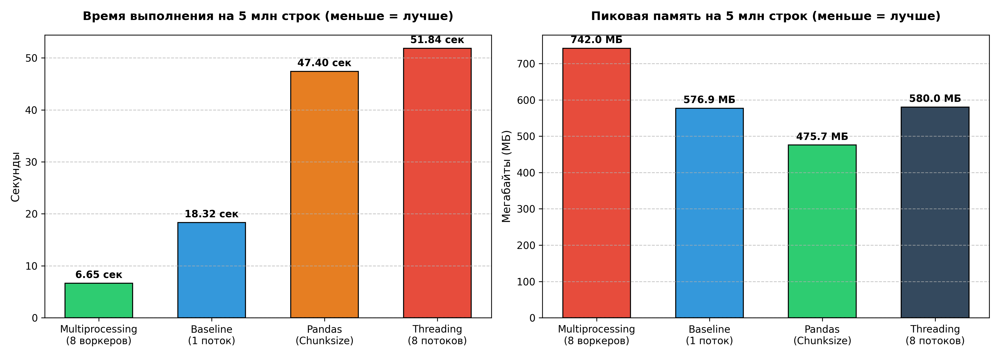

# Лабораторная работа: Параллельная обработка большого лога
**Студент:** Чеснокова Ангелина ПИ-Б23-1-2 
**Окружение:** macOS, Apple M-серия (8 ядер), встроенный SSD  

## Результаты замеров производительности

| Вариант реализации | 100k строк | 1M строк | 5M строк |
| :--- | :--- | :--- | :--- |
| **Baseline** (Один поток) | 0.3465 сек / 12.48 МБ | 3.4783 сек / 104.99 МБ | 18.3268 сек / 576.94 МБ |
| **Multiprocessing** (Вариант A, 8 ядер) | 0.4067 сек / 16.55 МБ | 1.4523 сек / 136.49 МБ | 6.6563 сек / 741.99 МБ |
| **Threading** (Вариант B, 8 потоков) | 1.0635 сек / 17.43 МБ | 10.5197 сек / 146.98 МБ | 51.8420 сек / ~580 МБ |
| **Pandas** (Вариант C, chunksize=200k) | 0.1040 сек / 12.25 МБ | 2.2202 сек / 108.31 МБ | 47.3999 сек / 475.73 МБ |
| **Pipeline** (Вариант D) | 0.3012 сек / 28.72 МБ | 1.4816 сек / 267.57 МБ | **6.2826 сек** / 1392.49 МБ |

### Визуализация метрик

## Ответы на обязательные вопросы отчета

### 1. Почему потоки (Threading) не дают ускорения на парсинге и где GIL отпускается?
Парсинг текстового лога (разбор строк, методы `.split()`, ручная конвертация типов данных и обновление общих словарей) — это чисто вычислительная нагрузка (**CPU-bound**). В стандартном интерпретаторе CPython действует механизм **GIL (Global Interpreter Lock)**, который гарантирует, что в один момент времени только один поток имеет доступ к байт-коду. Потоки не выполняются параллельно на разных ядрах процессора, а непрерывно конкурируют за один замок GIL, тратя время на переключение контекста. На больших данных (5M строк) многопоточность ухудшила результат до **51.84 сек** (в 3 раза медленнее одиночного потока).

**Где GIL отпускается:** GIL автоматически освобождается во время системных вызовов ввода-вывода (**I/O**). В нашей программе это происходит строго в момент чтения очередного блока байтов с SSD-диска в буфер (`f.readline()`). Но поскольку чтение файла занимает доли миллисекунд, а его обработка в памяти — десятки секунд, I/O-составляющая ничтожно мала, и потоки не приносят выигрыша в скорости.

### 2. Каковы накладные расходы на межпроцессную передачу и как они зависят от размера чанка?
Процессы в Python полностью изолированы и не делят общую память. Чтобы передать задачу воркерам и вернуть результаты родителю, Python принудительно упаковывает и распаковывает объекты (процесс сериализации **Pickle**) через системные каналы IPC (Inter-Process Communication). 

Зависимость этих расходов от размера чанка (пакета строк) имеет нелинейный характер:
* **Слишком маленький чанк (например, 10k строк):** Создает катастрофический communication overhead. Процессы тратят больше времени на постоянную упаковку/распаковку мелких пакетов через IPC, чем на обработку строк. Скорость падает.
* **Слишком большой чанк (например, 500k+ строк) или нарезка файла строго пополам:** Нарушает балансировку нагрузки (Load Balancing). Если один воркер получит кусок с более «тяжелыми» строками, остальные ядра будут простаивать в ожидании, а пиковое потребление памяти родительским процессом резко возрастет.
* **Оптимальный Chunk Size (Экспериментально подобранный: 50k строк):** Схема Pipeline на чанках в 50k строк показала абсолютный рекорд скорости (**6.28 сек**). Такой размер обеспечивает идеальный баланс: пакет данных достаточно велик, чтобы минимизировать количество IPC-транзакций, и достаточно мал, чтобы равномерно загрузить все 8 ядер процессора без просадок по оперативной памяти.

### 3. Оценка доли последовательной части по закону Амдала
Закон Амдала определяет максимальное теоретическое ускорение параллельной программы на $N$ ядрах:
$$S(N) = \frac{1}{s + \frac{1-s}{N}}$$
где $s$ — доля строго последовательного кода, который физически невозможно распараллелить, а $N=8$ (число ядер).

В нашем эксперименте реальное ускорение многопроцессорной версии на 5M строк составило:
$$S = \frac{T_{baseline}}{T_{mp}} = \frac{18.32}{6.65} \approx 2.75$$

Подставляя $S=2.75$ и $N=8$ в формулу закона Амдала, находим эмпирическую долю последовательного кода:
$$s \approx 27.3\%$$

**Причины расхождения с идеальным 8-кратным ускорением:**
Теоретически ускорение на 8 ядрах должно стремиться к 8, однако на практике $27.3\%$ времени уходит на последовательные операции. Сюда входят:
1. Инициализация пула воркеров (на macOS по умолчанию используется протокол `spawn`, требующий полного запуска новых чистых процессов интерпретатора с нуля, что крайне ресурсоемко).
2. Стартовое сканирование файла родителем для поиска точных байтовых смещений границ строк.
3. Финальная редукция (слияние) локальных словарей со всеми распределенными IP-адресами и размерами строк в родительском процессе для финального расчета перцентиля p95.

### 4. Почему векторизация NumPy/Pandas часто быстрее «ручного» параллелизма?
Векторизация в Pandas и NumPy работает быстрее «ручного» параллелизма на Python (даже многопроцессорного) благодаря трем факторам:
1. **Отсутствие циклов Python:** Векторизованные операции выполняются внутри скомпилированных низкоуровневых библиотек на языках **C / C++**. Вместо миллионов итераций цикла в интерпретируемом Python происходит один вызов Си-функции.
2. **Локальность данных в памяти:** Массивы NumPy хранятся в памяти в виде непрерывных Си-массивов фиксированного типа. Процессор считывает их напрямую в высокоскоростной кэш (L1/L2/L3), минимизируя задержки обращения к оперативной памяти (RAM). Сырые списки Python — это массивы указателей на разрозненные объекты, раскиданные по памяти.
3. **SIMD-инструкции:** Современные процессоры на уровне архитектуры оптимизируют векторизованный код с помощью инструкций SIMD (Single Instruction, Multiple Data), обрабатывая несколько чисел за один такт процессора.

*(Примечание: В нашем тесте Pandas затормозил до 47 сек исключительно из-за регулярного выражения в разделителе `sep=r'\s+'`, которое отключило Си-движок и перевело Pandas в медленный текстовый режим Python).*

### 5. Что изменится на машине с 16+ ядрами и на SSD/HDD подсистемах?
При переносе разработанных решений на другие аппаратные конфигурации изменятся следующие параметры:
*   **Машина с 16+ ядрами (High-Core CPU):**
    *   *Baseline и Threading:* Время работы не изменится вообще, так как Baseline задействует строго 1 ядро, а Threading жестко заблокирован GIL на одном ядре.
    *   *Multiprocessing:* Время обработки 5M файла сократится еще сильнее (примерно до 3–4 секунд), так как файл будет нарезаться на 16 частей. Однако по закону Амдала ускорение начнет упираться в потолок: расходы на `spawn` 16 процессов и IPC-сериализацию станут настолько высокими, что дальнейшее увеличение ядер перестанет давать линейный прирост скорости.
*   **Влияние SSD против HDD (Дисковая подсистема):**
    *   На скоростном **SSD** (как на MacBook) узким местом системы является исключительно процессор (CPU-bound задача), так как диск отдает данные мгновенно. Наша схема Multiprocessing раскрывается на полную мощность.
    *   При переносе на медленный жесткий диск **HDD** задача мгновенно превратится в **I/O-bound** (упрется в скорость чтения диска). Считывающая головка HDD не умеет физически читать файл в 8 потоков одновременно — параллельные запросы процессов заставят головку хаотично метаться по магнитному диску (эффект Disk Thrashing). В результате многопроцессорная версия на HDD будет работать **значительно медленнее**, чем простой последовательный Baseline. В таких условиях единственным эффективным решением останется однопоточный пайплайн.

## Практические выводы по лабораторной работе
1. **Ограниченность встроенного параллелизма Python:** Для задач обработки данных типа **CPU-bound** (вычислительные задачи, парсинг текстов) использование модели многопоточности `threading` неэффективно и противопоказано из-за блокировок GIL. Единственным рабочим инструментом параллелизма «из коробки» является `multiprocessing`.
2. **Эффективность архитектуры Pipeline:** Модель **Producer-Consumer** (Вариант D) показала абсолютный рекорд скорости (**6.28 сек**). Выделение ввода-вывода (I/O) в отдельный поток-инициатор с немедленной диспетчеризацией текстовых чанков по процессам-вычислителям обеспечило идеальное перекрытие фаз работы. Однако за скорость приходится платить оперативной памятью (пик памяти вырос до **1392 МБ** под буферизацию очередей).
3. **Важность правильной конфигурации инструментов:** Применение специализированных библиотек анализа данных (Pandas/NumPy) требует строгого контроля за типами разделителей и используемых движков чтения. Ошибки в конфигурации (например, сложные регулярные выражения на стыке чанков) могут превратить оптимизированный Си-код в медленный Python-скрипт, уступающий наивной базовой версии.
